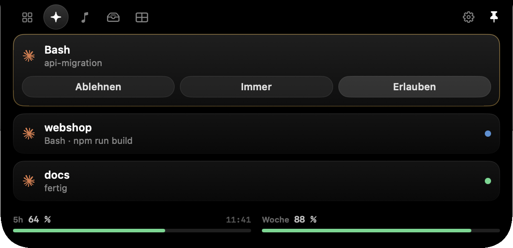

# Saphir

Die Notch deines MacBooks als Bedienfläche. Eingeklappt zeigt sie links und rechts der
Kamera, was gerade läuft, aufgeklappt eine Fläche mit Widgets.

*English in short: Saphir turns the MacBook notch into a control surface. It shows your
Claude Code sessions and lets you answer permission prompts and questions right there,
keeps the Mac awake with the lid closed, plays music controls, holds a file shelf and
more. macOS 14.4 or later, Apple Silicon. The interface is in German. Licensed under
AGPL-3.0.*



## Was drin ist

| Funktion | Was sie tut |
|---|---|
| Claude Code | Laufende Sessions mit Zustand. Freigaben und Fragen (`AskUserQuestion`, Pläne) direkt in der Insel beantworten, Sprung in den exakten Terminal-Tab, die echten Rate-Limits (5 Stunden und Woche) samt Warnung, wenn es knapp wird. Eingeklappt die Claude-Marke links, ein Punkt je Session rechts |
| Deckel zu | Hält den Mac auch bei zugeklapptem Deckel wach, immer mit Ende (1 h, 4 h, 8 h). Der Motor stammt aus [Insomnia](https://github.com/krishhgg/Insomnia) |
| Musik | Cover, Titel, Steuerung, Fortschritt. Eingeklappt Cover links, vier Equalizer-Balken rechts (echter Pegel aus dem Systemton) |
| Spotify-Bibliothek | Plus neben dem Titel legt das Stück in die eigene Bibliothek (Einrichtung siehe unten) |
| Datei-Regal | Dateien an die Notch ziehen, später wieder herausziehen |
| Batterie | Mac plus jedes verbundene Gerät, AirPods mit links, rechts und Etui |
| Kalender | Nächste Termine, fünf Minuten vorher eine Meldung in der Insel |
| Wach halten | Ruhezustand und Bildschirmabschaltung aussetzen, mit oder ohne Ende |
| Anti-Blaulicht | Ab 18 Uhr an die Brille erinnern, ab 20 Uhr den Nachtmodus anbieten |
| Augenpause | Alle 20 Minuten 20 Sekunden in die Ferne schauen |
| Zwischenablage | Verlauf der letzten 20 Texte, nur im Arbeitsspeicher |
| Notizen | Schnellnotizen, bleiben über den Neustart |
| Snap-Zones | Fenster an acht Plätze docken |
| Tonausgabe | Zwischen den Ausgabegeräten wechseln |
| Lautstärke und Helligkeit | Eigene Anzeige an der Notch statt der grauen des Systems |

Jede Funktion lässt sich einzeln abschalten. Was aus ist, läuft auch nicht im
Hintergrund.

**Nicht dabei:** Face ID, die Bezahlfunktionen des Originals (Blip, Circle to Search,
Sport und Finanzen), Widgets auf dem Sperrbildschirm (macOS erlaubt fremden Apps dort
keine Oberfläche) und eine Ladegrenze für den Akku (sie bräuchte einen Helfer mit
Root-Rechten). Geplant, aber noch nicht gebaut: Helligkeits-Boost, Nearby Share,
Menüleiste anpassen, Kurzbefehle.

## Voraussetzungen

- macOS 14.4 oder neuer (wegen des Prozess-Taps für den Pegel der Musikbalken)
- ein MacBook mit Notch. Ohne Notch läuft Saphir auch, bedienbar über das Symbol in
  der Menüleiste
- zum Selbstbauen Xcode oder die Command Line Tools (Swift 6)

## Installieren

### Fertige App

Unter [Releases](../../releases) liegt `Saphir-<Version>.zip`. Entpacken und nach
`/Programme` ziehen. Die App ist nicht von Apple notarisiert, deshalb blockiert
macOS sie beim ersten Start. Einmalig freigeben:

```
xattr -dr com.apple.quarantine /Applications/Saphir.app
```

oder in den Systemeinstellungen unter Datenschutz und Sicherheit auf *Trotzdem
öffnen* gehen. Die Kopie ist ad-hoc signiert; macOS merkt sich erteilte Freigaben
(Bedienungshilfen, Kalender, Automation) dadurch nur bis zur nächsten Version.

### Selbst bauen

```
git clone https://github.com/luismarks361/saphir.git
cd saphir
./build.sh --install      # baut, signiert und legt Saphir nach /Applications
open -a Saphir
```

Reines Swift und SwiftUI, keine Fremdpakete, kein Xcode-Projekt.

```
./build.sh                 Release bauen und Paket schnüren
./build.sh debug           schneller Bau, gleiches Paket
./build.sh --install       zusätzlich nach /Applications legen
./build.sh --adhoc --zip   ad-hoc signieren und dist/Saphir-<Version>.zip packen
./build.sh --version 0.4.0 Version setzen
```

Wenn ein Apple-Development-Zertifikat im Schlüsselbund liegt, signiert `build.sh`
damit. Das ist besser als ad-hoc: die Identität der App bleibt über alle Bauten gleich
und macOS wirft die erteilten Freigaben nicht weg.

## Mit Claude Code verbinden

*Einstellungen, Seite Claude Code, Knopf **Mit Claude Code verbinden**.* Oder in der
Insel auf der Claude-Seite.

Saphir trägt dazu in `~/.claude/settings.json` zwölf Hooks und eine Statuszeile ein.
Die Hooks sind ein kleines bash-Skript (`~/.saphir/saphir-hook.sh`), das das Ereignis
an einen Server auf `127.0.0.1` schickt. Für Freigaben hält es die Verbindung offen,
bis du in der Insel entschieden hast.

- **Vorher verändert Saphir nichts.** Erst der Knopf schreibt in `~/.claude`.
- **Was dort steht, bleibt.** Fremde Hooks werden nicht angefasst, eine vorhandene
  Statuszeile wird weitergereicht. Ist die Datei kein gültiges JSON, bricht Saphir ab
  und lässt sie unberührt.
- **Vor jeder Änderung liegt eine Sicherung** in `~/.saphir`. Trennen nimmt alles wieder
  heraus und stellt die alte Statuszeile zurück.
- **Nichts bleibt hängen.** Fragst du nicht in der Insel, geht die Frage nach einer
  einstellbaren Frist ans Terminal zurück. Läuft Saphir nicht, fragt Claude Code wie
  gewohnt im Terminal. Antwortest du im Terminal, verschwindet die Karte in der Insel.
- Bereits laufende Claude-Sessions kennen die Hooks erst nach einem Neustart.
- Die echten Prozente von Anthropic gibt es nur im Statuszeilen-Payload von Claude
  Code, einen anderen Weg gibt es nicht. Deshalb braucht Saphir die Statuszeile. In den
  Einstellungen lässt sich das Drucken in die Zeile abschalten, die Zahlen holt Saphir
  trotzdem.

Der Hook `PermissionRequest` kann nur von einem Programm sinnvoll beantwortet werden.
Hat sich ein anderes dort eingetragen, fragen beide.

**Immer erlauben:** Der Knopf merkt sich eine Regel wie `Bash(npm test:*)`. Sie gilt
nur für den Befehl selbst, nicht für Angehängtes (`npm test; ...`), und Saphir
schlägt sie nur für harmlose Fälle vor. Die gemerkten Regeln stehen in den
Einstellungen und lassen sich dort wieder löschen.

## Deckel zu einrichten

Damit der Mac bei zugeklapptem Deckel wach bleibt, braucht Saphir `pmset disablesleep`
mit Root-Rechten. Einmalig im Terminal:

```
./doku/deckel-einrichten.sh
```

Das Skript legt `/etc/sudoers.d/saphir-deckel` an und fragt einmal nach deinem
Passwort. Die Regel erlaubt **genau vier Befehle** ohne Passwort (Ruhezustand und
Energiesparmodus ein und aus) und gilt für jedes Programm unter deinem Benutzer, nicht
nur für Saphir. Rückgängig mit `./doku/deckel-entfernen.sh`. Details und Herkunft in
`doku/deckel-herkunft.md`.

## Spotify verbinden

Das Plus am Musik-Widget braucht ein eigenes Spotify-Konto: Spotifys
AppleScript-Wörterbuch kennt kein Speichern, nur die Web-API kann das. Einmalig, in
**Einstellungen, Seite Spotify**:

1. Auf [developer.spotify.com/dashboard](https://developer.spotify.com/dashboard) eine
   App anlegen (kostenlos, kein Abo nötig)
2. Als Redirect URI genau `http://127.0.0.1:8731/saphir` eintragen
3. Die Client-ID in Saphir einsetzen und auf *Mit Spotify verbinden* drücken

Angefragt werden nur `user-library-read` und `user-library-modify`. Die Anmeldung läuft
per PKCE, also ohne Client-Geheimnis; das Zugriffsrecht liegt im Schlüsselbund, nicht in
einer Datei. Ohne diesen Schritt bleibt das Plus weg, alles andere am Musik-Widget
arbeitet unverändert.

## Freigaben von macOS

| Freigabe | Wofür |
|---|---|
| Bedienungshilfen | Lautstärke- und Helligkeitstasten abfangen, Fenster andocken |
| Kalender | Nächste Termine |
| Automation | Musik in Spotify und Musik.app steuern, Terminal-Tabs für den Sprung finden |
| Ortungsdienste | Wetter (standardmäßig aus) |

macOS fragt jede Freigabe genau einmal. Ohne Freigabe bleibt die betroffene Funktion
einfach aus.

## Von außen steuern

`doku/steuern.sh` schickt verteilte Mitteilungen an die laufende App. Das braucht keine
Berechtigung und ist der Weg für Skripte und Kurzbefehle:

```
./doku/steuern.sh auf | zu | einstellungen [bereich]
./doku/steuern.sh seite <start|agenten|musik|regal|kalender|zwischenablage|notizen|zonen|einstellungen>
./doku/steuern.sh wach [minuten|aus]
./doku/steuern.sh deckel [minuten|aus]
./doku/steuern.sh agenten [verbinden|trennen|status]
./doku/steuern.sh freigabe [erlauben|ablehnen|immer]
./doku/steuern.sh nacht [an|aus|angebot]
./doku/steuern.sh funktion <name> [an|aus]
```

Der lokale Server für Claude Code hat dazu eine kleine HTTP-Schnittstelle auf
`127.0.0.1` (`/state`, `/decide`, `/jump`, `/panel`). Port und Token stehen in
`~/.saphir/endpoint.json` (nur für dich lesbar), jeder Aufruf braucht den Token im
Header `X-Saphir-Token`.

## Datenschutz

Alles läuft lokal. Keine Cloud, keine Telemetrie, kein Konto. Saphir spricht nur mit
`127.0.0.1` und, wenn du es einrichtest, mit der Spotify-Web-API sowie, wenn du das
Wetter einschaltest, mit open-meteo.com. Laufzeitdaten (Protokoll, Regal, Notizen, Sicherungen) liegen in
`~/.saphir`.

## Entwickeln

```
swift build          Debug-Build
swift test           Tests (rund 390, auch gegen echtes bash und curl)
```

| Was | Wo |
|---|---|
| Notch, Fenster, Form | `Sources/Saphir/Notch/` |
| Widgets und Dienste | `Sources/Saphir/Widgets/`, `Sources/Saphir/Dienste/` |
| Claude Code (Hooks, Server, Freigaben) | `Sources/Saphir/Agenten/`, `Dienste/AgentDienst.swift` |
| Deckel zu | `Sources/Saphir/Deckel/` |
| Einstellungen | `Sources/Saphir/UI/` |
| Notizen zur Herkunft | `doku/` |

Der Quelltext des Originals gehört nicht in dieses Repo. Wer beim Abgleich danebenlegen
will, holt ihn nach `.original/` (steht in der `.gitignore`):

```
curl -sL -o /tmp/s.tgz https://codeload.github.com/cshariq/Sapphire/tar.gz/refs/heads/main
mkdir -p .original && tar xzf /tmp/s.tgz -C .original --strip-components=1
```

## Lizenz

[AGPL-3.0](LICENSE). Saphir ist ein Nachbau von Sapphire (AGPL-3.0), die Claude-Sessions
stammen aus Agent Island, der Deckel-zu-Motor aus Insomnia (MIT). Alles Weitere, auch zu
Marken, steht in [NOTICE.md](NOTICE.md).
